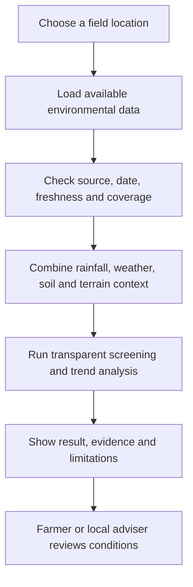

<p align="center">
  
</p>

<h1 align="center">Safe Field Nepal</h1>

<p align="center">
  <strong>Earth intelligence for every field.</strong><br />
  A Nepal-focused agricultural research prototype built for the
  <a href="https://www.spaceappschallenge.org/2026/challenges/field-shift-adapting-farms-with-nasa-data/">NASA Space Apps Challenge 2026</a>.
</p>

<p align="center">
  
  
  
</p>

<p align="center">
  <a href="https://www.spaceappschallenge.org/2026/challenges/field-shift-adapting-farms-with-nasa-data/">Challenge Brief</a>
  &nbsp;·&nbsp;
  <a href="docs/DATA_PROVENANCE.md">Data Provenance</a>
  &nbsp;·&nbsp;
  <a href="docs/VALIDATION_PLAN.md">Validation Plan</a>
</p>

> **Project links to add:** Replace the placeholders with your public URLs before publishing the final README.
>
> - **Live prototype:** `ADD_LIVE_PROTOTYPE_URL`
> - **Canva presentation:** `ADD_CANVA_PRESENTATION_URL`

---

## Overview

**Safe Field Nepal** is a location-aware agricultural research prototype designed to make environmental information easier to understand at field level. It brings together rainfall information, NASA climate data, soil-texture estimates, terrain context and short-term weather outlooks, then presents the available evidence with its source, date, freshness and limitations.

The project is designed around Nepal's agricultural context. A farmer can select a location using the map, GPS or a district workflow, review the available field conditions, and see a transparent screening result rather than an unexplained recommendation.

The interface supports **English and Nepali**.

## Challenge context

Safe Field Nepal was developed for **Field Shift: Adapting Farms with NASA Data**. The challenge asks teams to create decision-support tools that combine NASA Earth observations with local soil information, crop characteristics and farmer priorities to help farmers explore crop-rotation strategies that can support soil health and resilience under changing environmental conditions.

### Current scope

The current working prototype focuses on **field location, environmental context, rainfall and weather evidence, climate-trend exploration, and cautious fertilizer-timing screening**. It does **not yet generate, rank or compare crop-rotation plans**. A crop-rotation comparison workflow would require additional crop-calendar and rotation data, farmer-priority inputs, locally reviewed agronomic rules and field validation.

This distinction is intentional: the repository describes what is implemented today and does not present planned functionality as completed work.

## What the prototype does

### 1. Field location and mapping

- Select a location through the map, GPS or the district-selection workflow.
- Use a one-tap map selection to begin an assessment; drawing a boundary is optional.
- Draw a field polygon to estimate its area and, where supported by the rainfall grid, calculate an area-weighted rainfall estimate.
- View a street map using MapLibre GL JS and OpenFreeMap, with optional Esri World Imagery.
- The current assessment API is geographically bounded to Nepal coordinates between **26.3–30.5° N** and **80.0–88.3° E**. The API identifies Morang, Sunsari, Jhapa and Ilam as pilot districts.

### 2. Rainfall and weather context

- Prefer a fresh, locally cached **NASA GPM IMERG Late** daily rainfall grid for the recent 72-hour rainfall assessment.
- When a usable IMERG cache is unavailable, the current assessment endpoint attempts **Open-Meteo past-days reanalysis**. If no usable local-scale value is available, rainfall is marked unavailable instead of being silently treated as zero.
- Use NASA POWER data for historical and regional climate context, including daily precipitation, air temperature and modelled wetness variables.
- Show a short-term forecast from Open-Meteo, clearly identified as a non-NASA source.

### 3. Soil and terrain context

- Retrieve predicted sand, silt and clay fractions from **ISRIC SoilGrids**.
- Show the estimate's depth and resolution so it is not mistaken for a field soil test.
- Retrieve elevation and slope context from the Open-Meteo Elevation API, which uses Copernicus DEM GLO-90 as its primary dataset, with the Open-Elevation service as a fallback. Slope is estimated from a local 3×3 elevation stencil; the fallback service's DEM lineage is not independently verified.

### 4. Climate-trend exploration

- Examine historical heavy-rain-day frequency using NASA POWER daily records.
- Calculate a Theil–Sen trend slope and use a Mann–Kendall test with an autocorrelation adjustment.
- Present the result as exploratory historical evidence, not as a local forecast or a guarantee of future conditions.

### 5. Explainable screening and safety context

The deterministic prototype engine evaluates available rainfall, forecast, soil-texture, wetness and slope inputs. It returns one of the following screening labels:

- `CONDITIONS LOOK SUITABLE`
- `WAIT AND RECHECK`
- `LOCAL REVIEW NEEDED`

These labels are not fertilizer rates, application instructions, safety certifications or proof that fertilizer is required. The numeric thresholds are prototype design assumptions and have not yet been validated by Nepalese agronomists. Missing or unusable data must remain visible and trigger local review rather than a favourable default.

### 6. Farmer records and offline awareness

- Record crop setup and field activities, including farmer-entered rainfall and irrigation notes.
- Farmer-entered records are identified as user input, not independently verified observations.
- The frontend can use a recent browser-cached assessment when offline. Cached results retain their original observation and retrieval timestamps and are labelled as cached data, not new measurements.

## How it works



The assessment is designed to preserve data provenance. The displayed result should be interpreted alongside the data receipt, source freshness, spatial resolution and caveats for each input.

## Data sources

| Data source | Use in Safe Field Nepal | Important limitation |
|---|---|---|
| [NASA GPM IMERG](https://gpm.nasa.gov/data/imerg) — Late daily cache | Recent rainfall grid when a fresh local cache is installed | Approximately 0.1° grid spacing (around 10 km); it is not a field sensor. Polygon estimates require adequate valid-cell coverage. |
| [NASA POWER](https://power.larc.nasa.gov/) | Historical and regional precipitation, air temperature (`T2M`) and modelled wetness proxies (`GWETTOP`, `GWETROOT`) | Coarse reanalysis-based grid (roughly 55 km at Nepal latitudes); daily values can be delayed. Wetness variables are proxies, not SMAP or in-situ measurements. |
| [Open-Meteo](https://open-meteo.com/) | Short-term forecast and past-days reanalysis rainfall fallback | Non-NASA model data; forecast and reanalysis uncertainty apply. |
| [ISRIC SoilGrids](https://soilgrids.org/) | Predicted soil texture fractions | 250 m prediction for 0–5 cm topsoil; not a plot-level soil test. |
| [Open-Meteo Elevation API](https://open-meteo.com/en/docs/elevation-api) (Copernicus DEM GLO-90; primary) and [Open-Elevation](https://open-elevation.com/) (fallback) | Elevation and slope context | Slope is estimated from a local 3×3 elevation stencil. The Open-Elevation fallback's DEM lineage and resolution are not independently verified. |
| [OpenFreeMap](https://openfreemap.org/) and [Esri World Imagery](https://www.esri.com/) | Map display and optional imagery layer | Map providers have their own attribution, availability and usage terms. Imagery availability does not guarantee field-level detail. |

**Data transparency:** The live assessment's data receipt is the best place to confirm which rainfall source supplied a particular result. The backend currently prefers a fresh IMERG cache and then tries Open-Meteo past-days reanalysis; NASA POWER rainfall remains regional context if a local-scale rainfall value is unavailable. Some older repository notes describe the fallback differently and should be kept synchronized with `backend/app/api/routes.py`.

### Data not currently connected to the field-assessment endpoint

- GPM IMERG Final
- SMAP soil-moisture observations
- NASADEM

The project does not claim these datasets are integrated into the current assessment.

## Technology stack

| Layer | Technologies |
|---|---|
| Frontend | Next.js, React, TypeScript, Tailwind CSS |
| Maps and visualisation | MapLibre GL JS, Recharts, Lucide React |
| Backend API | Python, FastAPI, Pydantic, Uvicorn |
| Scientific analysis | NumPy, SciPy, pymannkendall, statsmodels |
| IMERG ingestion and geospatial processing | earthaccess, xarray, netCDF4, Shapely, pyproj, SQLite cache |
| External data services | NASA POWER, NASA GPM IMERG, Open-Meteo, ISRIC SoilGrids, Open-Elevation |

## Run locally

### Prerequisites

- Python 3.11 or later
- Node.js and npm
- Git

### 1. Clone the repository

```bash
git clone https://github.com/SuprimOjha/safefield-nepal-spaceapps-2026.git
cd safefield-nepal-spaceapps-2026
```

### 2. Start the backend

On Windows PowerShell:

```powershell
cd backend
python -m venv .venv
.\.venv\Scripts\Activate.ps1
pip install -r requirements.txt
uvicorn app.main:app --reload --port 8000
```

### 3. Start the frontend

Open a second terminal from the repository root:

```powershell
cd frontend
npm install
npm run dev
```

Open **http://localhost:3000** in your browser. Set `NEXT_PUBLIC_API_BASE_URL` when the backend is not available at the frontend's default local API address.

### 4. Optional: install GPM IMERG Late rainfall data

The field-assessment API reads the local IMERG cache; it does not download satellite granules during a farmer request. To populate the cache, configure a root `.env` file using `.env.example` and your own NASA Earthdata Login credentials. Never commit `.env` or credentials.

From the `backend` directory:

```bash
python -m pip install -r requirements.txt
python -m app.cli fetch-imerg --days 7
```

See [`backend/docs/IMERG_FETCH.md`](backend/docs/IMERG_FETCH.md) for ingestion details. Upstream authentication, data availability and the cache must be checked in the local environment.

## Tests and quality checks

Backend tests:

```bash
cd backend
pytest
```

Frontend scripts available in `frontend/package.json` include:

```bash
npm run build
npm run lint
npm run test:i18n
npm run test:field-survey
npm run test:ask
```

These commands are provided for local verification. Their presence in this README does not imply that every test has passed in every environment.

## Repository guide

| Path | Description |
|---|---|
| `frontend/` | Next.js web application and user interface |
| `backend/` | FastAPI services, data integrations, screening logic and tests |
| `docs/` | Data provenance, safety notes, validation plan and demonstration guidance |
| `aassets/` | Project logo and NASA Space Apps visual assets |

### Selected documentation

- [Data provenance and limitations](docs/DATA_PROVENANCE.md)
- [Prototype decision-rule register](docs/RULE_REGISTER.md)
- [Farmer handling safety](docs/FARMER_SAFETY.md)
- [Scientific and field validation plan](docs/VALIDATION_PLAN.md)
- [GPM IMERG integration status](docs/IMERG_INTEGRATION_STATUS.md)
- [Research evidence status](docs/RESEARCH_EVIDENCE_STATUS.md)
- [Mobile usability requirements](docs/MOBILE_USABILITY.md)
- [Basemap provider notes](docs/ESRI_AND_BASEMAP_NOTES.md)
- [Judge demonstration checklist](docs/DEMO_AND_JUDGE_CHECKLIST.md)

## Brand assets

| Asset | File | Intended use |
|---|---|---|
| Primary project logo | `aassets/SFL.png` | Main Safe Field Nepal logo displayed at the top of this README |
| Transparent logo artwork | `aassets/SFT.png` | Alternate logo artwork for suitable backgrounds |
| NASA Space Apps Challenge artwork | `aassets/image.png` | Event identity / presentation material |

Keep asset paths and filename capitalization exactly as shown. GitHub paths are case-sensitive.

## Limitations and responsible use

Safe Field Nepal is an **educational research prototype**, not a validated agronomic advisory service. In particular:

- The screening thresholds are design assumptions pending review by qualified Nepalese agronomists.
- Satellite and gridded datasets represent areas much larger than an individual field. A drawn polygon does not increase the native resolution of the underlying data.
- SoilGrids is a modelled estimate, not a laboratory soil test.
- NASA POWER wetness variables are modelled proxies, not direct soil-moisture sensor measurements.
- Forecasts and reanalysis products carry uncertainty and must be distinguished from observations.
- The project has not established completed farmer trials, expert sign-off, real-device acceptance testing or production readiness.
- The current prototype does not calculate fertilizer doses or produce crop-rotation recommendations.

Farmers should verify conditions on the ground, follow the product label, use a suitable soil test and consult local agricultural extension services. Do not infer a fertilizer dose or application instruction from this application.

Read the [validation plan](docs/VALIDATION_PLAN.md) before using the project beyond demonstration and research.

## Acknowledgements

Developed for the **NASA Space Apps Challenge 2026**, under the challenge **Field Shift: Adapting Farms with NASA Data**. We acknowledge NASA and the open-data organisations that provide the scientific and geospatial datasets used by this prototype.

Safe Field Nepal is an independent team project. It is **not affiliated with, produced by or endorsed by NASA**. NASA data and logos remain subject to their respective source and usage terms.

---

<p align="center">
  <strong>From Earth data to clearer field context.</strong><br />
  Safe Field Nepal · NASA Space Apps Challenge 2026
</p>
